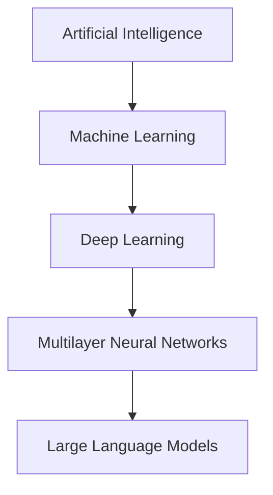
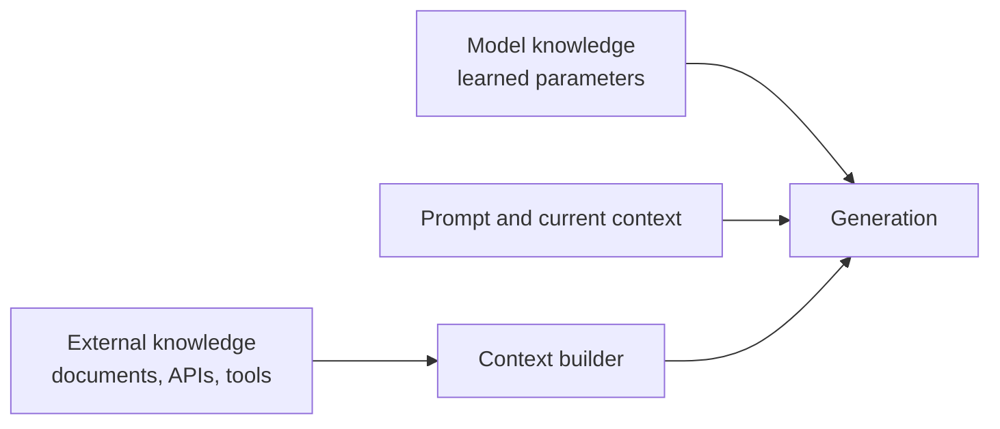
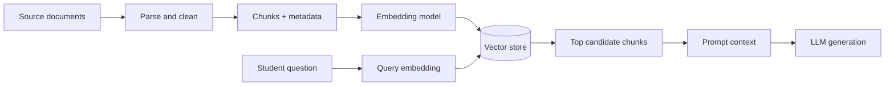
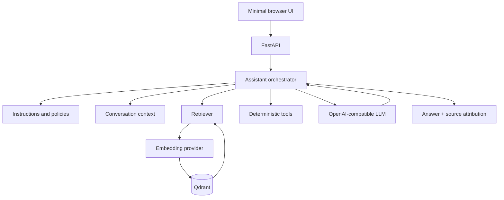

# Session 1 — From AI Models to Engineered Assistants (90 minutes)

## Learning outcomes

Students can explain why an LLM is not a database, identify the main layers around a model, trace a RAG request, and name failure modes caused by instructions, documents, retrieval, and generation.

## 0–10 min — AI, ML, deep learning, neural networks

AI is the broad engineering goal. Machine learning is a family of approaches that learn patterns from examples. Deep learning uses multilayer neural networks; modern LLMs are a deep-learning application.



Engineering examples: a hand-coded thermostat is automated control; a fault classifier learned from labeled vibration signals is ML; a vision model for component defects may use deep learning. Categories overlap in practice, so focus on the mechanism rather than marketing labels.

Ask: “If a system follows 500 hand-written rules, did it learn?” The point is to distinguish programmed behavior from learned parameters without arguing over the broad label AI.

## 10–22 min — Neural network intuition

A network receives numeric inputs. Weighted connections combine signals; activations introduce nonlinear behavior; layers build intermediate representations; the output encodes a prediction. Training adjusts weights to reduce a measured error across examples. Inference uses fixed learned weights on a new input.

Board example: predict whether a student may enjoy embedded systems from normalized features—hardware interest, programming interest, and tolerance for low-level debugging. Draw three inputs, two hidden units, and two outputs. Stress that real career guidance cannot responsibly be reduced to this toy classifier; it only illustrates computation.

```text
[hardware 0.9] ─┐
[coding   0.8] ─┼→ weighted sums → activations → [explore / not yet]
[debugging 0.7] ┘
```

Training asks “how should weights change across examples?” Inference asks “what output do the current weights produce now?”

## 22–40 min — LLM intuition and limitations

An LLM predicts a distribution over the next token from previous tokens. Tokens are pieces of text, not necessarily words. Repeating prediction produces a response. A transformer lets token representations interact through attention, which helps the model use relationships across its context; avoid describing attention as consciousness or human comprehension.

Training changes parameters using very large corpora. Inference does not search that training corpus; it computes from learned parameters and current context. The context window is a finite budget shared by instructions, conversation, retrieved evidence, user input, and output.

Temperature changes sampling: lower values often make likely choices more consistent, but do not guarantee truth or determinism. Outputs vary because generation samples from distributions and providers or context may change.

Hallucinations arise because plausible continuation and factual correctness are different objectives. Confidence in wording is not calibrated proof.



Ask students to classify claims as model knowledge, prompt/context, or external knowledge. One statement can involve more than one layer.

## 40–55 min — Prompt engineering as interface design

A robust application prompt defines:

- instructions: the task;
- role: useful behavior or expertise to simulate, not real credentials;
- context: task-specific information;
- rules: boundaries and priorities;
- output format: a contract for downstream users or code;
- examples: demonstrations of edge cases or desired structure;
- decomposition: smaller steps when a task has distinct retrieval, calculation, or validation phases.

Message layers have different origins. System instructions set product behavior. Developer/application instructions encode implementation needs. User messages express the immediate goal. Retrieved context supplies evidence and must be treated as untrusted data, not higher-priority commands.

Weak: `You are an assistant that helps engineering students.`

Improved: define scope, ask clarification when preferences are missing, explain fit and trade-offs, label assumptions, cite supplied sources, refuse invented statistics, and state when evidence is missing. Stronger instructions improve behavior; they do not mathematically guarantee it.

## 55–75 min — Discovering RAG

Pose: “According to our guide, what should an entry-level data engineer learn?” The model cannot reliably know a private workshop guide. Sending all documents wastes tokens, introduces distractions, and does not scale.



An embedding is a learned vector representation useful for similarity comparisons. It does not “understand” like a person. A vector store returns nearby candidates, not certified facts. RAG means retrieval-augmented generation: select external context, put it into the model call, then generate.

For “I like programming and want to work close to hardware,” semantic representations may surface “Embedded Systems” without exact phrase matching. Inspect results and scores; a score is relative evidence of vector similarity, not answer confidence.

Document quality governs the ceiling. Missing, duplicated, contradictory, stale, vague, or badly structured sources create downstream failures. Chunk boundaries and overlap trade completeness against noise. Metadata—role, domain, seniority, year, authority—supports filtering and conflict reasoning.

## 75–90 min — The assistant we will debug



Frontend shows the question, retrieved sources, and answer. FastAPI exposes stable interfaces. The orchestrator decides what context and tools to use. Instructions define behavior. Conversation state carries relevant prior turns. The retriever selects evidence using embeddings, Qdrant, and metadata. Tools perform bounded deterministic operations. The LLM generates language; source display and evaluation make behavior inspectable.

Close with: a useful assistant is a system whose components can each be inspected, tested, and improved—not merely an LLM plus a clever sentence.

