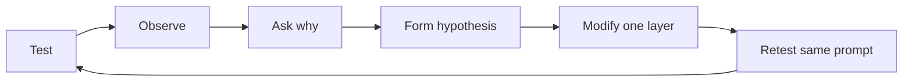

# Session 2 — Debugging an AI Assistant (90 minutes)

The practical follows one loop throughout:

## Core route

| Time | Scenario | Stage transition | Main lesson |
|---:|---|---|---|
| 0–8 | Setup and health check | `basic` | Stable infrastructure makes design failures observable. |
| 8–18 | Untraceable baseline | `basic` | Model output is not verified workshop knowledge. |
| 18–30 | Weak instructions | `basic → instructions` | Prompts are application behavior and boundaries. |
| 30–42 | Private knowledge and all-context trap | `instructions → all_context` | External knowledge must enter context, but indiscriminate context does not scale. |
| 42–58 | Basic RAG and retrieval debugging | `all_context → rag` | The retriever controls what evidence the model sees. |
| 58–74 | Document quality, metadata, dated conflict | `rag → better_retrieval` | Structure and provenance matter as much as model quality. |
| 74–86 | Ambiguity, conversation, and role tool | `better_retrieval → final` | Useful assistants gather context and use deterministic logic. |
| 86–90 | Evaluation and recap | `final` | Evaluate components and behavior, not exact prose. |

Optional extensions: tune chunk size/overlap live; compare filtered and unfiltered Qdrant queries; connect a real provider; review prompt-injection boundaries; add an answer validator.

Stage changes are made from the **Workshop journey** rail and take effect on the next message without a rebuild. The selected stage is isolated to the browser session, so each student can explore independently. Reindex only after RAG configuration or document changes. Detailed delivery cues are in [WORKSHOP_FLOW.md](WORKSHOP_FLOW.md).
